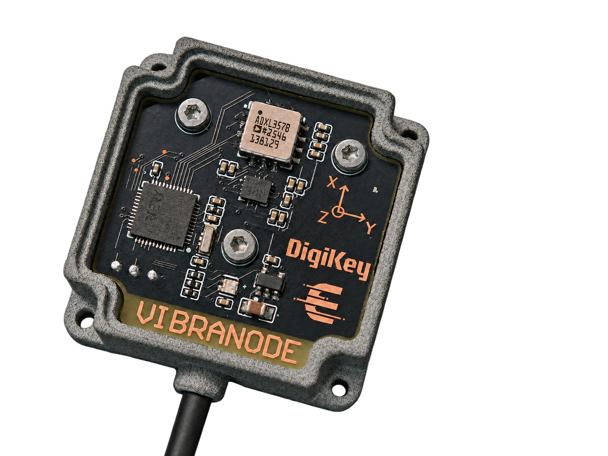

# VibraNode 振动探头固件

VibraNode 是配套 VibraScope 的 USB 振动探头。固件运行在 AT32F413CCU7 上，使用 SPI 采集 ADXL357 三轴加速度和 ICM42688 加速度及角速度，并通过 USB Full-Speed CDC 向 TAB5 或 PC 发送数据。



## 功能与硬件

- 产品实时档位为低速档和 ADXL357 4 kSPS + ICM42688 8 kSPS。更高的 ICM 速率用于诊断和吞吐实验。
- FIFO 批量读取、样本序号、时间估计、质量标志和 CRC 帧校验。
- 输出相对姿态和 ADXL357 温度，支持双加速度计六面标定与静态陀螺零偏标定。标定记录使用带 CRC 的双槽存储。
- USB CDC 使用 PA11/PA12，SWD 用于下载和调试，SEGGER RTT 用于板级诊断。

首版 PCB 的 X/Y 丝印互换。采集、姿态和标定使用传感器坐标，放置探头时以[实板标定说明](docs/milestones/2026-10-12-on-board-calibration.md)为准。

## 构建和烧录

1. 安装 Keil MDK 5、ARM Compiler 5.06 update 7 和 ArteryTek AT32F413_DFP 2.1.8。
2. 打开 [VibraNode.uvprojx](project/MDK_V5/VibraNode.uvprojx)，选择 `VibraNode` 目标并执行 Rebuild。
3. 用 SWD 调试器下载。生成的固件 HEX 位于 `project/MDK_V5/objects/VibraNode.hex`。

当前工程默认 `PROBE_HARDWARE_VALIDATION=0`，运行 USB CDC 应用。模式 1–3 用于不同层级的板级诊断，需显式设置。时钟和引脚以 `project/src/` 的固件为准，仓库中的 ATWP 文件为历史配置参考。新板的 64 KiB SRAM 配置见 [EOPB0 实板记录](docs/milestones/2026-09-10-eopb0-64k-sram.md)。

## PC 联调与测试

把探头通过 USB 接到电脑，找到新枚举的 CDC 串口。用 Python 3 安装 `pyserial` 后运行：

```powershell
python -m pip install pyserial
python tests/pc_host.py --port COM7 --config slow --seconds 10 --dump capture.bin
python tests/pc_host.py --inspect capture.bin
```

`capture.bin` 是探头协议帧转储。TAB5 保存的 `.VNR` 是另一种录制格式，应使用 TAB5 仓库的 `tools/inspect-vnr.py` 解析。

```powershell
python tests/pc_host.py --selftest
python -m unittest discover -s tests -p test_pc_host.py
```

`tests/verify_build_modes.py` 可用本机 Keil 构建四种模式，默认工具路径为 `C:/Keil_v5`。其余 `tests/run_probe_*.py` 是 ARMCC + Unicorn 的仿真入口，需要相应的本机工具和 Python 依赖。仿真产物不用于硬件烧录。

## 代码布局

| 路径 | 内容 |
| --- | --- |
| `project/src/`、`project/inc/` | 采集、USB 协议、时间映射、标定和状态灯 |
| `project/MDK_V5/` | Keil 工程和启动代码 |
| `middlewares/`、`libraries/` | 传感器驱动、姿态库、USB 栈、RTT 和芯片支持代码 |
| `tests/` | PC 联调、协议测试和仿真夹具 |
| `docs/milestones/` | 实板验证、吞吐和标定记录 |

更多实板说明见 [USB CDC 链路](docs/milestones/2026-10-10-usb-cdc-link.md)和[状态灯](docs/milestones/2026-10-10-led-language.md)。第三方许可声明保留在各依赖目录中。

## 许可

自研软件采用 PolyForm Noncommercial 1.0.0，商业使用需单独授权。适用范围及第三方许可见 [LICENSING.md](LICENSING.md)。
